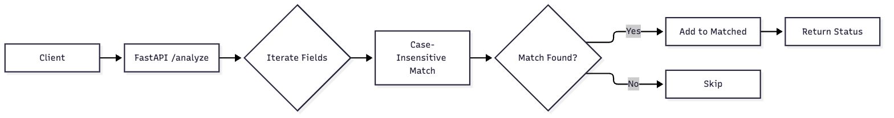
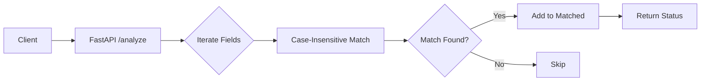

# VeriForm

Ensure legal consistency and completeness of high-stakes visa applications.

# Risk Analyzer MVP

A simple FastAPI service that checks if form fields appear in raw text.

## Usage

1. Install dependencies: `pip install -r requirements.txt`
2. Run server: `uvicorn main:app --reload`
3. Test: `pytest -q`

## Architecture

Mermaid source

